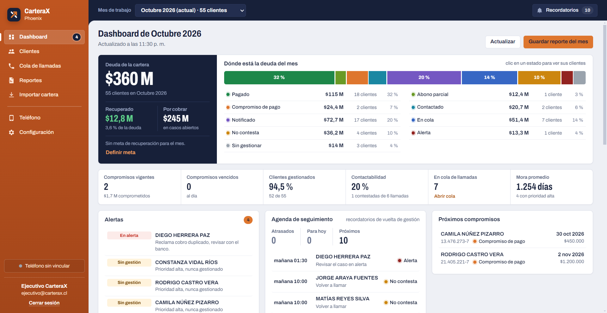

# CarteraX Phoenix

Aplicación de escritorio para que el **ejecutivo de cobranza** gestione su
cartera mensual: importa el Excel del banco, prioriza a quién llamar, registra
cada gestión con su estado y comentario, llama automáticamente desde un
teléfono Android (Phoenix Mobile) y guarda un reporte de cada mes.

Funciona **sin internet y sin servidor**: todo queda en una base SQLite en el
computador del ejecutivo (ERS: RNF-11, RNF-14).



## Probar desde el zip (en un PC sin nada instalado)

El zip trae sólo el código fuente. Las dependencias se descargan con
`npm install` la primera vez.

### 1. Lo que hay que instalar antes

| Qué | Para qué | Dónde |
|---|---|---|
| **Node.js 22 LTS** (incluye `npm`) | Instalar dependencias y ejecutar la app | <https://nodejs.org> → versión **22 LTS**, instalador `.msi` de Windows x64. Deja marcadas las opciones por defecto (agrega Node al PATH). |
| **Conexión a internet** (sólo la primera vez) | `npm install` descarga unos 300 MB (Electron, SQLite, etc.) | — |

No se necesita git, Python ni Visual Studio: SQLite se instala ya
compilado para Electron. Sólo si `npm install` termina con un error de
`better-sqlite3` / `node-gyp` (pasa en equipos sin binario precompilado),
instala además:

- **Python 3** — <https://www.python.org/downloads/> (marca *Add python.exe to PATH*).
- **Visual Studio Build Tools 2022** con la carga *Desarrollo para el escritorio con C++* — <https://visualstudio.microsoft.com/es/visual-cpp-build-tools/>.

Luego borra la carpeta `node_modules` y repite `npm install`.

### 2. Instalar y abrir

1. Descomprime el zip (clic derecho → *Extraer todo*) en una carpeta
   **fuera** de OneDrive si es posible, por ejemplo `C:\CarteraX`.
2. Abre una terminal en esa carpeta: en el Explorador, escribe `cmd` en la
   barra de direcciones y pulsa Enter.
3. Comprueba que Node quedó instalado (debe mostrar `v22.x`):

   ```bash
   node -v
   ```

4. Instala las dependencias (una sola vez, tarda unos minutos):

   ```bash
   npm install
   ```

5. Abre la app (compila y abre la ventana):

   ```bash
   npm start
   ```

6. Ingresa con `ejecutivo@carterax.cl` / `CarteraX123!` e importa
   `ejemplos/cartera_ejemplo.xlsx` para probar.

Para cerrar, cierra la ventana. Las próximas veces basta con `npm start`.

La app abre siempre la interfaz moderna (ver [NOVA.md](NOVA.md)).

### 3. Generar el ejecutable (.exe) e instalarlo

Con las dependencias ya instaladas (paso 2.4), en la misma terminal:

```bash
npm run dist:win
```

Tarda unos minutos (la primera vez descarga NSIS, necesita internet). Al
terminar, en la carpeta `release\` quedan:

| Archivo | Uso |
|---|---|
| `CarteraX-Phoenix-0.3.1-instalador.exe` | Instalador: doble clic → *Siguiente* → elige carpeta → *Instalar*. Crea acceso directo en el escritorio y en el menú Inicio. |
| `CarteraX-Phoenix-0.3.1-portable.exe` | Versión portable: se abre con doble clic, sin instalar. |
| `release\win-unpacked\CarteraX.exe` | La app sin empaquetar (útil para probar rápido). |

Windows SmartScreen puede advertir que el editor no es reconocido (el
instalador no está firmado): *Más información → Ejecutar de todas formas*.
Para desinstalar: *Configuración → Aplicaciones → CarteraX → Desinstalar*
(los datos en `%APPDATA%\CarteraX\` se conservan).

Si sólo quieres la carpeta con el `.exe`, sin instalador, usa
`npm run dist:dir`. Si falla con `EPERM` o un error de enlaces simbólicos
(`Cannot create symbolic link`), abre la terminal **como administrador** o
activa el *Modo de desarrollador* de Windows y repite.

### 4. Opcional

| Comando | Para qué |
|---|---|
| `npm run prueba` | Ejecuta las pruebas automáticas (deben terminar en 0 fallas). |
| `npm run simulador-movil` | Simula el teléfono Android en otra terminal; en la app, *Teléfono* → *Buscar teléfonos* y escribe el código que muestra la terminal. |

### Si algo falla

| Mensaje | Solución |
|---|---|
| `'node' no se reconoce…` | Node no está instalado o falta reiniciar la terminal tras instalarlo. |
| `npm.ps1 no se puede cargar… ejecución de scripts deshabilitada` | Estás en PowerShell: usa `cmd` (paso 2) o escribe `npm.cmd install` / `npm.cmd start`. |
| Error de `better-sqlite3` o `node-gyp` en `npm install` | Instala Python 3 y Build Tools (ver arriba), borra `node_modules` y repite. |
| `EPERM` / `EBUSY` al instalar | Cierra la app y el antivirus temporalmente, o descomprime fuera de OneDrive. |
| La ventana no abre | Ejecuta `npm run build` y revisa el error que muestre. |

Los datos de la app quedan en `%APPDATA%\CarteraX\` (no dentro de
la carpeta del zip).

## Descargar e instalar

| Equipo | Archivo |
|---|---|
| Windows | `CarteraX-Phoenix-<versión>-instalador.exe` (o la versión `portable.exe`, sin instalar) |
| macOS | `CarteraX-Phoenix-<versión>-mac-<arch>.dmg` |
| Linux | `.AppImage` o `.deb` |
| Teléfono Android | `PhoenixMobile-<versión>.apk` |

Los archivos se generan solos en GitHub: pestaña **Actions → Instaladores →
Run workflow**, y al terminar se descargan desde el run. Para publicarlos como
*Release* del repositorio:

```bash
git tag v0.3.0
git push origin v0.3.0
```

Windows puede advertir que el instalador "no es de un editor reconocido"
porque no está firmado digitalmente: elige *Más información → Ejecutar de todas formas*.

**Primer ingreso:** `ejecutivo@carterax.cl` / `CarteraX123!`. Cambia la
contraseña en *Configuración*.

## Cómo se trabaja

1. **Importar cartera.** Arrastra el Excel o CSV y elige el **mes** al que
   pertenece. La vista previa muestra qué columnas se reconocieron. Reimportar
   el mismo mes actualiza deudas y contactos, sin borrar estados ni gestiones.
2. **Dashboard.** Deuda del mes, recuperado, por cobrar, avance de meta, la
   franja de deuda por estado (cada tramo abre los clientes de ese estado),
   compromisos, contactabilidad, actividad diaria, deuda por tramo y por
   rango, y alertas (compromisos vencidos, gestiones agendadas, clientes
   prioritarios sin gestión).
3. **Clientes.** Busca por RUT, nombre, patente, teléfono o correo. Filtra
   por estado, deuda mínima y máxima, días de mora, tramo, comuna, teléfono y
   prioridad; ordena por prioridad, mayor o menor deuda, mora o compromiso.
   Al abrir un cliente, registra la gestión: nuevo estado, comentario,
   compromiso o abono y próxima gestión. Todo queda en el historial del caso.
4. **Cola de llamadas.** Selecciona clientes y pulsa **Enviar a la cola**.
   Al iniciar la cola, Phoenix Mobile los llama de a uno por prioridad. Si el
   cliente contesta, la cola **espera a que registres el resultado** y sigue
   sola; si no contesta, prueba sus otros teléfonos y, sin respuesta, lo deja
   en «No contesta».
5. **Reportes.** Guarda un reporte cuando quieras (cortes de quincena, por
   ejemplo). Al terminar cada mes se guarda solo el **cierre del mes**. Cada
   reporte se puede volver a ver y descargar en Excel, PDF o CSV.
6. **Mes de trabajo.** El selector de la barra superior permite volver a un
   mes anterior y ver su cartera, sus gestiones y su dashboard.

### Estados de cobranza

| Estado | Para qué se usa |
|---|---|
| Sin gestionar | Aún no se trabaja este mes |
| **En cola** | **Entra a la cola automática de llamadas** |
| Contactado | Se habló con el titular, sin acuerdo |
| No contesta | Se llamó y nadie respondió |
| Notificado | Se informó la deuda (llamada, correo o carta) |
| Compromiso de pago | Pagará en una fecha (obligatoria) y un monto |
| Abono parcial | Pagó una parte (monto obligatorio) |
| Pagado | Deuda regularizada (registra lo recuperado) |
| No pagado | Incumplió el compromiso o se niega a pagar |
| Alerta | Requiere atención: reclamo, riesgo o caso especial |
| Inubicable | Teléfonos erróneos o titular no ubicable |
| No contactar | Pidió no ser llamado o está en cobranza judicial |

Los estados se definen en un solo lugar: `src/dominio/estados.ts`.

### Prioridad

Cada cliente tiene un score de 0 a 100 (`src/dominio/prioridad.ts`):
deuda dentro de la cartera (40), días de mora (25), estado (20) y días sin
gestión (15). Los casos cerrados valen 0. La cola y el orden por defecto lo usan.

## Phoenix Mobile (Android)

1. Instala el APK (`PhoenixMobile-0.4.0.apk`) y abre la app. Deja todo en
   verde en «Para que no se corte»: llamadas, estado del teléfono, registro de
   llamadas, notificaciones y batería sin restricción.
2. Conecta el teléfono y el computador a la misma Wi‑Fi.
3. En CarteraX → **Teléfono**, pulsa **Buscar teléfonos**, elige el tuyo y
   escribe el código de 6 dígitos que muestra la app. Desde ese momento el
   teléfono sólo recibe llamadas de este computador.

La app sigue funcionando en segundo plano mientras el marcador está abierto,
así que la cola registra sola si contestaron y los minutos. Si el teléfono se
corta, se reinicia o pierde la Wi‑Fi, la cola pide el resultado en vez de
quedarse esperando. Las llamadas que se cortan sin sonar en pocos segundos
quedan como «apagado o sin cobertura», y a la tercera vez ese número se
descarta como inexistente (se puede reactivar en la ficha).

Para compilarla: abre `movil/android` en Android Studio. Detalles en
[`movil/android/README_ANDROID.md`](movil/android/README_ANDROID.md).

## Para desarrollar

Requisitos: Node.js 22 (ver `.nvmrc`).

| Comando | Qué hace |
|---|---|
| `npm install` | Instala dependencias y compila SQLite para Electron |
| `npm start` | Compila y abre la app |
| `npm run prueba` | 37 pruebas del cargador + 58 de reglas de negocio + 1 de importación segura |
| `npm run capturas` | Regenera las capturas de diseño en `docs/capturas/diseno/` (base temporal) |
| `npm run simulador-movil` | Simula Phoenix Mobile. Opciones: `--codigo=123456`, `--contesta=siempre\|nunca\|rapido`, `--no-marca`, `--sin-vinculo`, `--sin-seguimiento`, `--sin-permiso` |
| `npm run dist:win` / `dist:mac` / `dist:linux` | Genera el instalador en `release/` |
| `npm run ejemplos` | Regenera los archivos de `ejemplos/` (datos ficticios) |

La base vive en la carpeta de datos del usuario
(`%APPDATA%\CarteraX\carterax_fusion.db` en Windows). Las bases de
versiones anteriores se actualizan solas al abrir la app.

### Estructura

```
src/
├── main.ts                 Proceso principal: ventana, menú, instancia única
├── preload.ts              Puente seguro: window.phoenixAPI.invocar(canal)
├── tipos/contratos.d.ts    Tipos compartidos backend ↔ interfaz
├── ipc/
│   ├── rutas.ts            Canal IPC → servicio (sin Electron, se prueba con Node)
│   └── manejadoresIpc.ts   Diálogos, PDF, respaldo (lo que depende de Electron)
├── dominio/                Estados de cobranza y score de prioridad
├── servicios/              Cartera, dashboard, reportes, exportación, cola,
│                           móvil, períodos, autenticación, configuración
├── importacion/            Lectura CSV/Excel, mapeo de columnas, normalización
├── movil/clienteMovil.ts   Protocolo HTTP con Phoenix Mobile
├── db/                     Esquema, migraciones, conexión, configuración
└── renderer/               Interfaz: un script por vista + app.ts
movil/android/              Phoenix Mobile (Kotlin)
pruebas/                    Pruebas automáticas
.github/workflows/          Compilación de instaladores y APK
```

Arquitectura: [`docs/arquitectura/documento.html`](docs/arquitectura/documento.html).
